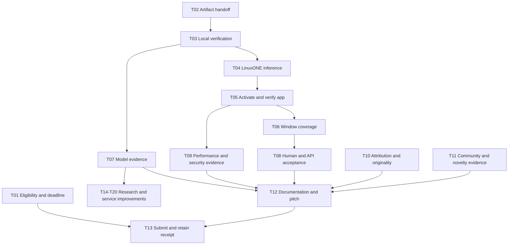

# Quasar: complete gap-closure plan for the incoming developer

**Start here if you are taking over development.** This plan turns the [rubric audit](DATATHON-DEV-HANDOFF.md) into executable work. It covers the submission requirements, the working demo, the engineering gaps and the research needed for stronger claims. The companion [workboard](DATATHON-WORKBOARD.md) is the place to assign owners and record completion.

Prepared October 17, 2026, against source **`665b3e2`**. Scope is **Okaloosa County, Florida, FIPS `12091`**. Status is a repository checkpoint, not a fresh verification of the running server. This document proposes work; it does not mean that work has been performed or authorize shared infrastructure changes.

## 1. What you are inheriting

Quasar already has a county data application, parcel inspection, an archived WeatherNext timeline, a locally trained XGBoost model, portable inference, assessment production and an exposure API. Your first job is to connect and prove that existing system on LinuxONE.

The model predicts the fraction of a parcel mapped as FEMA Special Flood Hazard Area. It does **not** predict whether the parcel flooded. An experimental formula combines that output with forecast rainfall. Keep that distinction in the app, video, model card and submission.

| Already available in code or committed reports | Still needs completion or evidence |
| --- | --- |
| Source app, county checks, parcel cache, source reports and model-detail UI | Fresh end-to-end run and Isaac's visual acceptance |
| Recorded county inventory of 113,818 parcels and 45 archive forecast cells | Transfer of actual ignored artifacts to your machine; checksum and identity verification |
| Recorded trained model `mapped-susceptibility-v1-7673922e5dca` and evaluation | Retrieval and review of actual weights, evaluation, model card and test ledger |
| Portable standard-library inference and assessment CLI | Real model inference on LinuxONE, benchmark and screenshots |
| Recorded authenticated LinuxONE county-data API | Current host/release verification and activation of a matching model assessment |
| One local assessment for Oct 9, 00:00–06:00 Central | App demonstration of that exact window; optional engineering for other windows |
| Research code for outcome modeling | Verified observations, coverage-backed negatives and a qualified outcome experiment |
| Local test baseline | Optional ML/GIS tests, real-artifact checks, target-host checks and manual review |

The current workspace has no `data/` directory. Cloning or receiving a branch will not transfer model weights, GIS files, databases, credentials, videos, receipts or `.context` files. Get them from the responsible teammate through the agreed private handoff channel. Do not access another Conductor workspace to collect them yourself.

Read these in order: [README](../README.md), [runtime contract](data-contract.md), [first model run](modeling-run-v1.md), [modeling commands](modeling.md), [activation record](real-data-rollout.md), then the task relevant to your work below. The older exposure handoff and general roadmap retain historical sections; do not use their obsolete producer-missing tasks as your implementation baseline.

## 2. What “finished” means

There are three distinct outcomes. Report which one you have reached.

| Outcome | Required evidence | What it does not establish |
| --- | --- | --- |
| **Submission complete** | Eligibility/prerequisites resolved, accessible code and video, correct title/fields, submission receipt | A good score, a validated flood model or a deployed production service |
| **Demonstration complete** | Actual LinuxONE inference and aggregation, matched app result, reproducible artifacts, passed checks, visual review, honest pitch | Observed-flood accuracy, live warning delivery or safe navigation |
| **Research/operational gaps closed** | Independent outcome evaluation, physical/source limitations investigated, measured reliability/usability and a reviewed operational scope | An automatic safety certification or a guarantee of no flooding |

Tasks T01–T13 close the immediate handoff and submission gaps. T06 has a deadline-safe single-window path and a larger multiwindow path. T14–T20 define the work to close the remaining research and operational gaps. Some require new source access, domain review or user authorization. If those inputs cannot be obtained, retain an explicit open item and narrow the claim; do not mark the capability complete because its limitation is documented.

## 3. Ownership, working rules and first hour

Assign actual names in the workboard. One person can hold several roles, but each task needs one accountable owner.

| Role | Responsibility |
| --- | --- |
| Incoming developer | Integration, focused code changes, checks, evidence ledger and handoff status |
| Isaac | Artifact/access coordination, scope decisions and rendered visual acceptance |
| Model/data owner | Existing training artifacts, source lineage, evaluation and future experiments |
| IBM/runtime owner | Authorized host access, current service inventory, activation and rollback |
| Team lead | Eligibility, lab/attendance records, organizer clarification, final title and submission |
| Presenter | Evidence-based story, recording, timing, link/access checks |
| Domain reviewer, when available | Flood-process assumptions, observation labels and interpretation; do not invent this person or a partnership |

The developer should own technical execution, not chase every administrative receipt personally. If working alone, ask the lead for one consolidated administrative status while continuing local code/artifact work.

**First hour:**

1. Record your name, checkout/revision, working branch and available time. Inspect `git status --short`; preserve existing work. Do not rename this branch.
2. Ask the lead for the exact cutoff including time zone, selected theme/track, team name, roster status and both lab receipts. This is T01.
3. Ask Isaac/model owner for the T02 bundle, expected hashes and the approved access contact. Do not begin a new acquisition or training run.
4. Read the five current references above and choose the single-window demo as the initial integration target.
5. Run the offline baseline checks in T03. Establish where private evidence and public summaries will live.
6. Record blockers with the responsible person, next action and next check time. Move to an independent task rather than silently changing scope.

Work on feature branches. Shared API/schema changes need coordination before implementation. Stage only named files; hand off reviewed PRs to `preview` when authorized. Do not push `main`, deploy, restart services, change shared infrastructure or access IBM Z without explicit authorization. A requested plan does not authorize those actions. Real notification/contact collection remains outside this plan's implementation scope.

## 4. Order of execution and deadline choices



This is a team task dependency diagram, not a request for automated agents. Only parallelize work when separate people own compatible files. Keep one owner on contracts, release activation and each notebook.

The following are **planning estimates**, not commitments. Transfer speed, missing receipts, source access, host readiness and organizer response can dominate elapsed time. Re-estimate after the first hour.

| Work bundle | Approximate focused effort | Scheduling guidance |
| --- | --- | --- |
| T01–T03: administrative check, artifact recovery, baseline | 1–3 hours plus transfer/response waits | Begin immediately; lead handles administration alongside technical setup |
| T04–T05: on-host inference and integration | 2–4 hours if access, release and artifacts are compatible | Critical path; stop and reconcile identity/version failures |
| T06 single-window acceptance, T07–T09 evidence | 2–4 hours | Reuse existing code; do not add multiwindow storage under time pressure |
| T10–T13: attribution, story, recording, submission | 2–4 hours, some alongside integration | Presenter can prepare verified sections before final app capture |
| T06 multiwindow implementation | 1–3 development days plus measured full-run time | Separate change after one-window proof; not required by the guidebook |
| T14–T20: research and operational improvement | Multiple iterations over days or weeks; data access may take longer | Do not promise completion in the datathon window |

Let **C** be the organizer-confirmed submission cutoff. Aim for the technical scope freeze at **C−3 hours**, first full recording by **C−2 hours**, uploads and access checks by **C−1 hour**, and receipt verification by **C−30 minutes**. These are team buffers, not event deadlines. If you are already inside a buffer, narrow scope and move directly to the required evidence; do not extend the cutoff by assumption.

- **At least 8 focused hours available:** pursue all immediate tasks, using the single-window path first. Add optional improvements only after a working recording exists.
- **3–8 hours available:** prioritize prerequisite resolution, real LinuxONE inference, one supported window, model limitations and the required video/code package. Keep multiwindow/live-feed/new-model work off the deadline path.
- **Less than 3 hours available:** preserve the last proven demo, record only what is true, and finish the required package. If a mandatory prerequisite cannot be established, ask the organizer; a partial demo is not proof of compliance.

If LinuxONE access fails, prepare local artifacts, logs and the pitch while the runtime owner resolves access. A local fallback is useful rehearsal evidence but does not close the LinuxONE requirement. If source data are missing, do not recolor real parcels with synthetic scores.

## 5. Immediate implementation tasks

### T01 — Resolve eligibility, prerequisites and deadline

**Owner:** team lead. **Dependencies:** none. **Covers:** audit R1–R5, R10–R12; guidebook pp. 4, 7, 12, 15–20, 22.

1. Collect individual registration, 4–6-member team creation, enrollment/track status, submitted abstract, mandatory session attendance and Discord membership status privately.
2. Obtain evidence for both IBM labs: Predictive AI Hybrid AI scenarios (multi-model), and Predictive AI + Generative AI. Record official lab title/version, who completed it, date and evidence location. Quasar's notebook is unrelated evidence.
3. Resolve missing/late prerequisite treatment with the organizer, including whether completion is required per participant or team. Keep the actual response; never backdate activity.
4. Confirm final cutoff and time zone with UTD POC/H2S. Resolve the guidebook's abstract-date conflict and “EST” wording. The post-event feedback/video date is not an assumed extension.
5. Confirm the actual team name, title, selected track/theme and consistency with the submitted abstract. Preserve event Git history and a short contribution record distinguishing pre-event research from event code.

**Deliverable:** private eligibility checklist with receipt links and a public-safe status summary. **Acceptance:** every required row is evidenced or has an organizer's documented disposition. “Asked someone” is not closed. **If blocked:** the lead owns escalation; developer proceeds with local preparation. No automated messages are sent by this planning task.

### T02 — Transfer and audit the artifact bundle

**Owner:** incoming developer; supplier: Isaac/model owner. **Dependencies:** none for requesting files. **Covers:** D1 and reproducibility.

Obtain the exact bundle listed in [audit D1](DATATHON-DEV-HANDOFF.md#d1--recover-and-verify-the-existing-artifacts-p0-incoming-developer--isaacmodel-owner): parcel SQLite and manifest, reconciled input SQLite and manifest, authoritative county geometry, matching inspection SQLite/manifest, saved archive, portable/native models, evaluation/model card, dataset/split/test-ledger records, local assessment/benchmark and source/transfer provenance.

1. Make a file inventory with relative path, role, bytes, SHA-256, source owner and required/optional status. Keep it outside public Git when it reveals private storage details.
2. Compare file hashes to producer manifests. Compare semantic identities separately: inventory source hash, boundary hash, dataset ID, model hash and forecast hash. Do not confuse an inventory identifier with the SQLite file hash.
3. Verify FIPS `12091`, county-boundary validation evidence, CRS/units/datum and processing lineage. A matching FIPS tag is insufficient.
4. Ensure the inspection manifest references the exact archive hash and reconciled parent manifest. Pair databases with their own manifests; do not mix releases.
5. Confirm transfer completeness without retraining: model and evaluation hash agree, test ledger is preserved, and the recorded model is the one being handed over.
6. Keep the previous bundle intact. If a file fails, quarantine that candidate and obtain a corrected copy; do not patch a manifest to accept unexplained data.

**Recorded identity anchors:** inventory `0d8bf9c244cbae678108bbc8149d80c60db30f60824e24cd49435f2b93b4fd5a`; model `c3896f84e4593bbe20af909aade20edf7d46e43459b79e7aa79d5dc13188457f`. Full identities and expected paths are in the audit and [training report](modeling-run-v1.md).

**Acceptance:** a received-and-verified manifest, successful model input audit, documented authoritative containment lineage, and no unexplained version mismatch. Recorded inventory count is 113,818. If newer artifacts differ legitimately, document the new release and rerun dependent checks instead of asserting the old result still applies.

### T03 — Establish your local baseline and optional research environment

**Owner:** developer. **Dependencies:** source checkout; T02 for real-artifact checks. **Files:** `package.json`, `pyproject.toml`, `requirements-modeling.txt`, `tests/`.

Run from the repository root:

```sh
git status --short
git rev-parse HEAD
python3 --version
node --version
npm --version
python3 -m unittest discover -s tests -v
npm ci --ignore-scripts
npm run check
npm test
npm run build
git diff --check
```

The preceding audit recorded 192 Python tests with 8 optional skips, 75 JavaScript tests, passing checks/build and unchanged compiled assets. Treat that as the old baseline, not your new run. Capture your own counts, skips, versions, revision and logs.

For model/GIS work, use a separate environment following [modeling setup](modeling.md#setup-and-local-research). Check whether an environment already exists before creating one. Run the Python suite there so native-export, spatial containment, preparation and outcome tests execute. Keep compiled ML/GIS packages out of the app runtime. If your architecture differs from the documented Mac environment, verify compatible packages before installation; do not silently substitute versions or assume the OpenMP workaround is portable.

Do not rerun real training merely to verify the checkout. Inspect existing evaluation/residual/ledger records and run synthetic tests. Notebook work is optional; assign an owner, import shared functions, clear outputs and execute in the optional notebook environment before handing off notebook changes.

**Acceptance:** reproducible environment notes, core checks green, relevant optional tests executed or explicitly unresolved, no unexpected generated diff, and a list of baseline failures separated from your changes. **Failure action:** fix the smallest reproducible issue before connecting shared services.

### T04 — Prove actual model inference on LinuxONE

**Owner:** developer + runtime owner. **Dependencies:** T02, T03 and authorized host access. **Files:** `quasar/modeling/{dataset,portable,production,__main__}.py`.

1. Have the runtime owner inventory the current release, Python version, architecture, service configuration and artifact paths. The committed activation report says a county API already exists; verify it rather than replacing it with an old standalone bridge.
2. Confirm data permissions and free disk/RAM/CPU. Keep staged outputs outside read-only service inputs until complete. Reuse immutable verified input files and write a new output path.
3. Run the exact `audit`, `assess` and `benchmark` sequence in [audit D2](DATATHON-DEV-HANDOFF.md#d2--execute-trained-inference-on-linuxone-p0-incoming-developer--ibm-integrator), using the transferred paths. Initial window is `2026-10-09T05:00:00Z` through `11:00:00Z`, `mode=replay`.
4. Capture the actual invocation, revision, Python, `uname -m`, model/evaluation/inventory/forecast identities, output run ID/hash, counts, elapsed seconds, peak RSS and disk free. Record production and R4–R7 aggregation separately and together.
5. Reconcile output with the existing Mac assessment across all parcel IDs: compare known/unknown status and missing reasons exactly; compare susceptibility and rainfall within `1e-6` absolute difference and the rounded index/factor contribution within `1e-5`. These are proposed acceptance tolerances for identical inputs, not measured new parity results. Exclude legitimate metadata differences such as computation time/run ID. Investigate differences before activation rather than widening tolerances after seeing a failure.
6. Capture redacted screenshots showing the actual instance, model and successful run. Isaac/the operator handles screenshots and visual review. Do not expose host credentials, tokens or unrelated account information.

Project targets are under 300 seconds and 2 GiB peak RSS for production plus aggregation, with at least 1 GiB free disk. These are internal targets, not official rubric limits. The recorded Mac result of 45.23 seconds is not an IBM result.

**Acceptance:** real county inference and aggregation on `s390x`, traceable output and measured resource report. A sample query, architecture string in a mock response or serving a precomputed Mac file does not close this task. **Failure action:** retain logs and previous service; diagnose path/identity/permissions/resource issues without weakening validation.

### T05 — Activate one assessment and verify the complete data path

**Owner:** integrator. **Dependencies:** T04 and authorization for configuration/restarts/deployment. **Files:** `quasar/exposure.py`, `bridge.py`, `server.py`, `ops/linuxone/`; [activation guide](real-data-rollout.md).

1. Prepare the exact change before approval: current and candidate release, input identities, new assessment path, environment setting names, restart/deploy steps, verification cases and rollback target. Keep secret values out of the review.
2. Back up current service/proxy/environment settings privately and retain the previous release/artifact. Change `QUASAR_EXPOSURE_FILE` on the inventory-serving host to the reviewed output. Preserve existing authentication and snapshot/parcel paths.
3. Confirm source requests require the parcel token; Vercel holds it server-side. Preserve HTTPS verification and narrow proxy routes. Never place tokens in `VITE_` variables, URL queries or browser code.
4. Verify the supported six-hour summary through the source host and the app API. Check model/hash, run, inventory, dates, counts and `aggregation_architecture`. Query actual scored and unknown parcel IDs with the summary's `run_id`.
5. Verify the UI in exposure mode with Isaac. The default rainfall map is a different layer, so rainfall color alone is not model proof.
6. Exercise inventory mismatch, wrong window, changed run and unavailable source using isolated tests or a designated staging configuration, not by breaking the shared demo. No failure may expose stale results as current or substitute fictional scores.

**Acceptance:** source → authenticated proxy → API → selected parcel/cell all show the same approved run/window. Unauthorized source reads fail; unknown remains unknown. **Rollback:** restore the recorded previous artifact/config/release, validate configuration and perform only authorized restart/reload. Recheck that the previous proven state or explicit unavailable state is restored. Do not roll back to fabricated data.

### T06 — Close the replay coverage gap deliberately

**Owner:** developer. **Dependencies:** T05. **Shared-contract coordination required for path B.**

**Path A, deadline demonstration:** keep the existing artifact contract. Demonstrate the one supported window, label its coverage, and show that another hour is unavailable rather than reusing scores. This completes a coherent demo; it does **not** complete all-hour model coverage. The app's 25 positions span Oct 9 midnight through Oct 10 midnight Central, with a forward six-hour window at each start. Each selected window must have all of its required source hours, including hours extending beyond midnight.

**Path B, complete replay coverage:** proposed implementation, not an existing feature:

1. Add a small versioned assessment catalog under `quasar/` that maps exact `(mode, valid_from, valid_to, inventory_id)` to an immutable single-window artifact, checksum and model/forecast identities. Keep current single-file configuration backward-compatible. Propose `QUASAR_EXPOSURE_CATALOG` as a new server-only setting; agree its name/precedence before coding.
2. Keep model and forecast provenance inside each single-window artifact. Do not merge independent windows under one top-level provenance object. Reject duplicate/conflicting catalog keys, mixed counties/inventories and unexpected model identities.
3. Resolve only catalog-listed relative paths beneath a configured artifact root. Reject absolute paths, traversal and escaping symlinks. Bound catalog size/window count; use immutable versioned filenames and verify hashes when loading a version, not on every warm request.
4. Add explicit offline orchestration that reads the actual timeline, lists eligible windows, runs the existing producer per window, and records success or reason for unavailable windows. No request starts production and no missing source hour becomes zero. Publish a catalog atomically only after validating its entries; retain the previous version for rollback.
5. Reuse a single bounded cache of decoded artifacts by content/version with eviction. Existing `_aggregate` and `_artifact` caches need measurement: do not retain 25 county JSON documents indefinitely or duplicate full parcel maps for each resolution. Precomputed immutable summaries may help, but preserve full-inventory denominators and use measured evidence before changing storage.
6. Preserve public API query shape and existing `run_id` refresh behavior. Add response fields only where needed to describe selected coverage. Keep unsupported windows explicit; ensure late responses cannot repaint a new selected hour.
7. Add catalog parsing/path tests, two distinct-window integration tests, out-of-order response tests, model/provenance mismatch tests, corrupt-file tests, rollback tests and memory/latency measurements. Update `data-contract.md`, `exposure-display.md` and `modeling.md` together.

The existing artifact is about 73 MB; 25 similarly sized files would be roughly 1.83 GB **before** duplicates, backups or parsed-memory overhead. This is a planning extrapolation, not a measured full-replay footprint. Each file must still satisfy the 128 MiB cap. Preflight actual disk and memory; do not concatenate all windows into one oversized JSON.

**Acceptance for path B:** every requested timeline position has either a matching, provenance-correct assessment or a documented genuine source-data gap; supported-window switching is correct; peak memory stays within the agreed host budget; rollback restores the prior catalog. If source hours are missing, the ingestion scope/access must be resolved separately; implementing a catalog does not manufacture complete coverage.

### T07 — Produce a reproducible model evidence package

**Owner:** model/data owner. **Dependencies:** T02; T04 for host claims. **Files:** training report, saved evaluation/residuals/model card, `quasar/modeling/training.py`.

1. Reconcile dataset/model/evaluation/test-ledger hashes, split block assignments, sample counts and unsupported rows from saved artifacts. Recompute recorded metrics from saved residuals where possible; do not retrain or reuse held-out labels for selection.
2. Explain the six predictors, target units, 10 km spatial blocks, 1 km buffer, grouped development folds, validation selection, final test and native/portable parity in plain language.
3. Report model and mean/ridge baselines on the identical supported test set, parcel-weighted and equal-block metrics, all excluded rows and subgroup errors. Retain the weak fully mapped subgroup; an aggregate gate pass does not erase it.
4. Label the rainfall formula and 50 mm constant as an uncalibrated interaction. Distinguish WeatherNext AI, trained FEMA proxy, deterministic interaction and aggregation.
5. Separate local training, LinuxONE inference and app evidence. Record dependency versions and source terms. Explain that ensemble spread is not a confidence interval and tree-path contributions are not physical causes.

**Deliverable:** concise public `model-summary.md` backed by private/full evaluation artifacts, source links, limitations and host-run evidence. **Acceptance:** a reviewer can trace every metric and claim to an artifact and reproduce the arithmetic without selecting a new model. If artifacts cannot substantiate a recorded metric, qualify or remove that metric from the pitch.

### T08 — Complete functional, usability and accessibility acceptance

**Owner:** developer for code/API tests; Isaac for rendered review. **Dependencies:** T05; chosen T06 path. **Files:** `quasar/static/{app,spatial,inspection,map-ui}.js`, `frontend/`, existing JS/Python tests.

Use the test matrix in section 7. In addition:

1. Walk one complete analyst task: identify date/source, inspect rainfall, switch to exposure, choose a parcel, explain score/unknown, inspect cell coverage and compare the selected hour across Map/Data/Reports.
2. Keep labels explicit: rainfall is mm per six hours; parcel index is 0–100; H3 rainfall maximum differs from H3 exposure P90. Do not sum overlapping H3 memberships as a unique county total.
3. Verify keyboard access, visible focus, logical focus return, programmatic labels, understandable loading/errors, zoom/text wrapping, readable contrast and non-color cues. Use reduced-motion behavior for playback where applicable. Isaac checks real rendered results and mobile/print readability.
4. Check map failure: source tables/reports and useful unavailable states remain accessible. Do not present empty geometry as zero exposure.
5. Verify no service credentials appear in browser configuration, network URLs, downloads or compiled assets. Use targeted tests and reviewed payloads; do not dump the environment into logs.

**Acceptance:** completed manual checklist with reviewer/date/revision, targeted regression tests for fixes, no unresolved critical wrong-time/unknown/safety-label issue. Current Reports export source rainfall; leave that contract clear. A model-result export would be a separately specified addition, not a promised existing feature.

### T09 — Measure performance and substantiate platform/security claims

**Owner:** runtime owner + developer. **Dependencies:** T04/T05; approved testing environment. **Files:** `production.py`, `exposure.py`, `bridge.py`, parcel APIs, deployment configuration.

1. Retain the T04 production/aggregation benchmark. Measure actual source and proxied API timings separately, cold and warm, for summary and 1/100-parcel lookups. Record response bytes, errors, peak memory and dataset identity.
2. Measure a small declared request sample before any concurrency/load test. On the shared host, obtain an agreed cap and stop conditions; avoid unbounded traffic. Report sample size and p50/p95 only when enough observations support them.
3. Check compatibility with implemented proxy timeouts and body-size limits. A fast warm request does not establish that a cold county aggregation fits its deadline. If it does not, precompute/cache reviewed summaries offline or reduce work based on profiling without changing score semantics.
4. Exercise authentication rejection, route allowlists, redirection policy, invalid artifact handling and read-only access in staging/tests. Review logging for secret exposure and record observed controls.
5. Measure frontend transfer/load if performance is a demonstrated issue. The existing large-chunk build warning alone does not justify a redesign; preserve layout and introduce narrowly scoped loading/code splitting only if measured.
6. Choose truthful platform evidence: real compute/aggregation, protected data path and measured limits. If containerization is claimed, verify actual `s390x` image build and run; a Dockerfile or x86 CI is insufficient. Do not add containerization solely for a screenshot when the working service is systemd-based.

**Acceptance:** reproducible bounded performance report, known timeout/memory limits, evidence for each security/platform claim and a failure/rollback record. Passing tests is not proof of confidential computing, acceleration, high availability or general enterprise security.

### T10 — Finish attribution, originality and code-access evidence

**Owner:** developer + lead. **Dependencies:** source/package inventory; T01 for originality questions.

Create `sources-and-attribution.md` containing actual dependency/source name, version/identifier, official project/source URL, license/terms link, use in Quasar, and required notice. Cover Python/JS libraries, vendored H3 notices, Mapbox, WeatherNext, Census, county parcels, FEMA, USGS, mapped waterways, reused icons/assets and UI template provenance. Inspect lockfiles for actual installed versions rather than guessing from version ranges.

Verify Shadcnblocks permission and event treatment of templates; do not describe a licensed template as self-authored code or assume it is open source. Preserve county reference-data disclaimer and attribution. If redistribution rights remain unclear, share the allowed code and acquisition/manifests rather than including the raw dataset in a public ZIP. Record unresolved terms with the lead; do not imply legal clearance from this plan.

Preserve event history and contributor notes. Confirm the judge-accessible repository points to the reviewed commit/`preview`, with reproduction instructions and no private artifacts. Final access is checked manually from the judge's perspective. Do not push `main` to fix a default-branch link.

**Acceptance:** all actually used resources have reviewed attribution, known restrictions are respected, originality questions have a documented disposition, and the code link works for the intended reviewer.

### T11 — Establish community value and a defensible novelty claim

**Owner:** presenter/lead, with developer input. **Dependencies:** selected theme, verified data; can begin before T05.

1. Pick one primary user and task. Recommended framing: a county analyst reviewing which parcels need closer investigation and why, using one dated forecast window. Describe the decision supported, not an evacuation or safety decision the system cannot make.
2. Build a short source-backed problem brief: affected place/population or documented incidents, date range, source ID/URL, method and limitations. Verify the old NOAA count from actual retained files before using it. Keep county-level incidents separate from parcel-level outcomes.
3. Compare the actual workflow with two or three existing references, such as an official weather viewer and FEMA mapping, using checked primary sources. Record capabilities with links and dates; mark uncertain features unknown. Do not invent competitor limitations or claim to replace official guidance.
4. Write the distinct contribution as a testable sentence: one view connecting forecast provenance, county parcel context, LinuxONE inference and explicit unknowns. Validate that the demonstration actually shows each piece.
5. If a willing reviewer is available, run the same information-finding task using existing separate sources and Quasar. Record participant role, task, order, time, errors and interpretation of unknowns. Counterbalance task order where feasible. Small convenience samples are usability observations, not proof of emergency outcomes.
6. Keep outreach manual/authorized. No fabricated interview, partnership, adoption or lives-saved metric. If no reviewer is available, use a clearly labeled team walkthrough and retain external value validation as open.

**Acceptance:** a clear theme-aligned problem statement, verified supporting evidence and a restrained originality comparison. Measured benefit is closed only when an actual study exists; describing a benefit hypothesis is not measurement.

### T12 — Update documentation and assemble the pitch package

**Owner:** presenter + developer. **Dependencies:** T07, T08, T09, T10, T11; use provisional labels until dependencies finish.

1. Update the current architecture: explicit import/preparation; local training; portable model; LinuxONE inference/assessment/H3 summaries; authenticated API; Vercel proxy; browser. Label actual versus planned components.
2. Remove or clearly archive obsolete public-flow descriptions: fictional sites, active routing/notifications, missing assessment producer, old passphrase gate and inactive pre-Okaloosa bridge. Preserve useful history without making it the start page.
3. Produce a one-page architecture visual, model summary, source/attribution page, a redacted LinuxONE evidence set, and a runbook for the selected demo hour.
4. Rehearse the 175-second storyboard in [audit D6](DATATHON-DEV-HANDOFF.md#d6--record-the-video-and-submit-p0-presenter--team-lead). Required contents are problem, supporting data, solution/demo, stack, LinuxONE instance and model. Put the real host/model evidence on screen rather than only naming IBM.
5. Verify narration against a claim ledger: claim, source artifact, revision/date, limit, approved wording. Remove unsupported claims. Have one teammate who did not implement the feature explain the model target and unknown state back to you.
6. Record a backup walkthrough of the proven build before optional changes. A backup recording preserves evidence; it cannot substitute for unmet mandatory prerequisites.

**Acceptance:** coherent architecture, current setup/docs, a timed full rehearsal, all claims sourced, visual acceptance and a working package independent of the developer's laptop.

### T13 — Validate and complete the submission

**Owner:** team lead + presenter. **Dependencies:** T01, T10, T12 and sufficient actual demonstration evidence.

Prepare a title containing the real team name, final code URL/revision, final video URL, open-source links, requested H2S fields and optional architecture/prototype. Measure the final encoded video's duration, including intro/outro: **no more than 180 seconds**. Check audio/readability and public/intended judge access to every link; uploaded/private assets may behave differently from local files.

Submit through the team account before the confirmed cutoff. Reopen the submitted record, verify exact title/links/files/track, and retain receipt, timestamp/time zone and a copy of final contents. Distinguish submitted from draft/uploaded/previewed. Keep member details and account receipts private. Confirm any post-event survey obligations separately.

**Acceptance:** a complete accepted submission record and accessible artifacts, not merely a ready folder. If the platform fails, retain the error/time and follow organizer instructions; do not claim delivery based on an attempted upload.

## 6. Plan to close the remaining scientific and operational gaps

### T14 — Investigate and improve the FEMA proxy's weak groups

**Owner:** model/data owner. **Dependencies:** T07; data/domain review. **Estimate:** several research iterations.

First reproduce the recorded subgroup findings and inspect data quality: terrain coverage, FEMA effective dates, overlap/conflict handling, coastal/open-water treatment, out-of-range predictors and spatial error concentration. Keep fully mapped, partially mapped and unmapped groups visible. The recorded fully mapped validation MAE of 0.779924 on 60 parcels needs investigation; do not hide it behind overall RMSE.

Write the experiment question and selection criteria before changing features or weights. Use development/grouped validation for ablations and any imbalance treatment. If test results have informed redesign, retain the old test as an already-examined benchmark and acquire/define a genuinely untouched evaluation set; recreating a dataset or deleting the ledger does not make it untouched. Report uncertainty and subgroup sample sizes, and assess whether improved mapped-fraction prediction is useful compared with simply showing the available FEMA layer.

Preserve the prior model and evaluation. A replacement needs source/dataset/version identities, leakage checks, baseline comparisons, support/abstention analysis, portable parity and review. Do not change the target or promote an outcome model under the old model name.

**Acceptance:** an independently reproducible report explaining the failure and either a defensible evaluated improvement or a justified decision to restrict the model's use. A negative experiment can finish the investigation; it does not close an unresolved accuracy limitation.

### T15 — Build and evaluate a real observed-outcome experiment

**Owner:** research/data lead, with independent label/domain review. **Dependencies:** T02/T07 and authorized access to suitable observations/forecasts. **Estimate:** data-dependent; potentially weeks.

1. Define one target before acquisition: for example, verified rainfall-driven parcel impact within the next six hours. Specify event inclusion, spatial uncertainty, outcome timing and intended use. Do not mix tide/surge impacts into a rainfall-only target without changing and documenting the task.
2. Inventory candidate evidence: NOAA Storm Events, county incident/closure records and verified high-water or field reports if accessible. Check source terms and actual availability. [NOAA's Storm Events portal](https://www.ncei.noaa.gov/access/storm-events-database/) is a discovery source; an incident entry is not automatically a parcel outcome or a non-flooded control.
3. Preserve original records and provenance; perform authoritative county geometry checks and explicit spatial association. Mark ambiguous associations unknown. Have the reviewer inspect samples and disagreements; record the labeling policy and confidence/uncertainty separately from model output.
4. Construct negatives only where observation coverage documents absence of the defined impact across the entire window. Missing reports, a location outside a report polygon or an unqueried county area are not automatically negatives.
5. Align decision times, forecast initialization/publication/validity, reference-layer availability and observation windows. Hash-match inspection overlaps to each forecast snapshot. A reference layer acquired later can support retrospective analysis but not an as-issued lead-time claim.
6. Use existing `validate-outcomes` and the contract in [modeling.md](modeling.md#conditional-observed-outcome-research). Current code requires at least 10 independent episodes, 200 positives, 200 negatives, required episode/spatial splits and class support. These are code gates, not guarantees of sufficient scientific evidence. Do not loosen them just to obtain a model.
7. Preregister baseline, features, split/threshold-selection rules, metrics and stop criteria. Existing experiments compare logistic regression and boosted candidates, with temporal and spatial holdouts. Keep threshold tuning on validation and the final test locked.
8. Report precision/recall, average precision, missed impacts/false alarms, per-event and per-location results, coverage and abstentions. If probability wording is proposed, add calibration/reliability evaluation and appropriate proper scoring metrics before using it. Review practical false-negative/false-positive costs with the intended user.

**Acceptance:** source-reviewed outcome dataset, auditable labels/coverage, valid leakage-resistant experiment and independent evaluation with limitations. If the evidence gate fails, publish an insufficiency report and retain the mapping proxy as a different research product. Do not claim flood validation because training code exists.

### T16 — Address missing hydrology, coastal and property context

**Owner:** data/GIS lead + domain reviewer. **Dependencies:** source access and T15 target definition for outcome modeling.

Create a feature/source inventory for floor elevation, terrain relative to drainage, drainage infrastructure/connectivity, channels/lakes/canals, tide/surge context and measured gauges. For each candidate record the question it could answer, authoritative source, geographic/temporal coverage, horizontal/vertical datum, units, availability at decision time, terms and expected missingness. Do not assume any candidate source exists or is usable in Okaloosa.

Separate stages: acquire minimally permitted data; validate coverage and containment; preserve source quality/unknowns; derive reusable features in `quasar/`; test units/geography/time alignment; then assess incremental value using T14/T15's evaluation rules. A gauge station point is not a water-level series or a hydraulic link to a parcel. Never subtract DEM from an incompatible BFE or invent floor elevations.

Use a domain-reviewed mechanism diagram to decide which features belong in a rainfall, coastal or compound-flood experiment. Keep mechanisms separate until evidence supports integration. Retain a limitation for processes the model cannot represent; low forecast rainfall cannot rule out surge.

**Acceptance:** validated, versioned feature artifacts and a documented evaluation of their usefulness, with unsupported mechanisms still explicit. A larger GIS inventory alone does not close physical-model limitations or establish depths.

### T17 — Add a measured current-forecast workflow and defensible lead time

**Owner:** integration/data lead. **Dependencies:** T06 storage strategy, T09 limits, explicit authorization for new cloud acquisition and any scheduling/infrastructure changes.

1. Confirm the desired live window and allowed scan budget. The present scope is the saved October 9 replay; new dates are a scope decision. WeatherNext entitlement is separate from a successful current connection.
2. Use the explicit county importer and query-budget audit. Check current [WeatherNext BigQuery documentation](https://developers.google.com/weathernext/guides/bigquery) for source schema/access details at implementation time; run a dry run, apply a byte cap and account for pending/reserved usage before execution. Do not query on app requests or enable notebook auto-querying.
3. Validate native geometry, duplicate/missing/null hours, units, initialization, publication when available, import and expiry. Never edit timestamps to make old inputs fresh. Rebuild compatible inspection overlaps when the forecast identity/geometry requires it.
4. Produce matching assessments offline and publish snapshot plus assessment/catalog references as one coherent version. Serve the previous version only with its correct validity/status; do not pair new weather with old model exposure.
5. Introduce an explicit current/archive selector only after the source/assessment path is complete. Preserve the archive demonstration. Test source switch, expiry while open, imports failing halfway, delayed source publication and out-of-order frontend responses.
6. If ongoing refresh is authorized, define a separately operated job with owner, schedule tied to source updates, lock, budget, timeout, bounded retries and failure alerting. Keep refresh outside request handling.
7. Measure latency from documented source availability through import, production and delivery. If publication time cannot be established, label timing initialization-based; do not claim operational warning lead time.

**Acceptance:** repeated valid current imports/assessments with bounded cost, source-consistent UI, correct expiry/failure behavior and measured availability-to-result latency. A single successful fetch closes connection testing, not ongoing real-time reliability.

### T18 — Integrate official NWS alerts without creating an all-clear

**Owner:** backend/data developer. **Dependencies:** agreed county coverage and source contract; separate from model scoring.

The existing `quasar/adapters/nws.py` queries curated fictional points and is not a county service. Replace that dependency in a new county-scoped integration; do not relabel it countywide. Review the current [NWS API documentation](https://www.weather.gov/documentation/services-web-api), including its geolocation/specification references, identifying User-Agent and pagination behavior. Verify relevant county/forecast-zone relationships rather than assuming one zone covers the county.

Propose a shared contract with `connected`, `status`, `retrieved_at`, source validity, coverage definition, official IDs/URLs, issue/onset/expiry, original text and failure reason. Distinguish fresh complete zero-result responses, partial coverage, stale results and disconnected/error states. Handle pagination, updates/cancellations, duplicate IDs, missing geometry, future/expired messages and service errors. Keep official alerts separate from experimental indices and never overwrite official instructions with a model recommendation.

Add deterministic fixtures/tests and bounded caching/retry rules. Display the actual coverage/time and source link. A successful empty response means only no matching alerts returned for that defined query/time; it is never proof of safety. Do not place present-day alerts on the October 9 replay. Historical alert playback requires independently sourced, time-aligned archive evidence.

**Acceptance:** reviewed coverage, correct official-message lifecycle, tested failures and clear UI. If complete county coverage is unresolved, retain an explicit partial/disconnected state rather than asserting countywide coverage.

### T19 — Establish operational ownership, reliability and adoption evidence

**Owner:** product/runtime lead. **Dependencies:** T08/T09/T17/T18, agreed intended use, additional authorization for broader operation.

Define who uses the service, what decisions it may support and which remain with official guidance. Name owners for imports, credentials, source terms, model versions, incidents, user feedback and backups. Agree service objectives from actual needs rather than marketing promises: freshness, availability, response latency, data retention and recovery.

Implement reviewed monitoring for source age/coverage, job success, assessment age/identity, API errors/latency, memory/disk and certificate/configuration health. Preserve structured, redacted logs and reproducible release metadata. Test backup restoration, artifact/catalog rollback, failed import and unavailable source in a designated environment. Review authentication/access, request limits, dependency maintenance and privacy appropriate to the deployment. Verify restoration, not just backup-file existence.

Run real-user pilots on explicitly non-emergency evaluation tasks, with agreed participation and measurement. Track task completion, errors, comprehension of uncertainty and usefulness. Document accessibility findings and fix them. Obtain domain review before expanding interpretation; a positive demonstration is not an agency endorsement or operational authorization.

**Acceptance:** named owners, measured service objectives, tested recovery, documented user/domain feedback and an approved operating scope. Real contact collection, notification sending, shelter/navigation routing and delivery credentials remain separate opt-in projects requiring explicit authorization; they are not required to close the datathon rubric.

### T20 — Build evidence for AI Innovation Excellence

**Owner:** model/research lead + presenter. **Dependencies:** T07/T11 and selected T14–T19 results.

Choose one specific technical contribution to investigate, not a collection of new AI buzzwords. Candidate questions include whether explicit abstention helps users avoid unsupported conclusions, whether portable inference preserves numerical fidelity at useful county-scale cost, or whether additional well-founded features improve held-out outcomes. These are experiment ideas, not claims of novelty.

Review primary literature/tools, state the comparison and what is actually new, preregister the experiment and run appropriate baselines/ablations. Measure model quality, coverage, resource cost and user impact separately. Report tradeoffs and failed hypotheses. Tie the contribution to a demonstrable community decision and credible adoption path without inventing adoption.

**Acceptance:** a supported differentiation statement and reproducible evidence of technical/impact benefit. Exceptional award consideration is at the judges' discretion; neither this plan nor a high standard score guarantees it. A conventional model plus integrations should be described honestly when stronger innovation evidence is unavailable.

## 7. Implementation map and acceptance tests

Existing code is reusable. Names marked **proposed** below are design suggestions, not files or commands already implemented.

| Tasks | Existing implementation to inspect | Expected focused work |
| --- | --- | --- |
| T02–T04, T07 | `quasar/modeling/dataset.py`, `portable.py`, `production.py`, `training.py`, `contracts.py`; `tests/test_modeling.py` | Audit, inference, metric/parity verification; fix only reproduced issues |
| T05–T06 | `quasar/exposure.py`, `server.py`, `modeling/production.py`; `tests/test_exposure.py`, `test_api.py` | Activation verification; proposed `quasar/exposure_catalog.py` and offline CLI extension for path B |
| T08 | `quasar/static/app.js`, `spatial.js`, `inspection.js`, `map-ui.js`; `frontend/`; JS tests | Narrow state, accessibility and source-label fixes; rebuild `quasar/static/ui/` |
| T09, T19 | `quasar/bridge.py`, parcel APIs, `ops/linuxone/`, `api/index.py` | Measured bottlenecks, reviewed configuration and operational runbook; no automatic infrastructure changes |
| T14–T15, T20 | `quasar/modeling/{dataset,training,outcomes}.py`; `tests/test_modeling.py` | Separate versioned experiments, preserved test ledgers and optional owned notebooks |
| T16 | `quasar/parcel_inputs.py`, `inspection_prepare.py`, `parcel_context.py`; `scripts/prepare_parcel_inputs.py`, `prepare_parcel_inspection.py` | Versioned source/feature preparation with units, coverage and geographic tests |
| T17 | `quasar/adapters/county_weather.py`, `query_budget.py`, `forecast_timeline.py`, `modeling/production.py`; weather/timeline tests | Explicit current ingestion, matching artifacts, source-selection and expiry tests |
| T18 | `quasar/adapters/nws.py`, `server.py`; proposed county-alert module/API tests | New county-scoped contract independent of fictional fixtures; lifecycle/coverage tests |
| T10–T13 | `docs/`, dependency manifests/lockfile, source and vendored notices | Public-safe attribution, current architecture, pitch and reproduction package |

Coordinate changes to the data/API contract before modifying producers and consumers. Keep reusable transformations and model logic in `quasar/`; notebooks orchestrate and present, not duplicate scoring.

### Acceptance test matrix

Run deterministic failure tests with isolated fixtures. Use the real reviewed artifacts for separate integration evidence. Do not corrupt shared data or interrupt a shared service to collect a test screenshot.

| Case | Required behavior | Evidence/owner |
| --- | --- | --- |
| Valid model/input/window | Same IDs, dates, score and factors through host, proxy and parcel details | Saved responses + Isaac review; developer |
| Missing/partial terrain or out-of-range predictors | Null assessment with specific reason | Model/API test and one actual example |
| Valid zero rainfall | Zero is preserved where otherwise eligible; no safety claim | Scoring/UI test |
| Null, duplicate, negative or missing forecast hours | Unknown or rejected according to contract; never zero-filled | Adapter/producer tests |
| Wrong county or inventory/boundary mismatch | Reject candidate; no fallback | Artifact/audit tests |
| Wrong forecast/inspection hash | Reject production/activation | Real-artifact audit plus fixture test |
| Unsupported hour | Explicit unavailable and cleared previous color | API test and manual hour change |
| Changed run during parcel request | Refresh/invalidate; no mixed-run result | API/JS race test |
| Current expiry while page remains open | Scores/rainfall cease appearing fresh | Controlled-clock test + human check |
| Replay old date | Deliberate historical window remains readable with reconstruction label | API/JS test |
| Late response after selection change | Cannot repaint new/closed selection | Existing/extended JS test |
| More than 100 or duplicate parcel IDs | Reject invalid request | API test |
| Partial browser parcel pagination | Full-inventory P90/coverage does not change as pages load | Aggregation/JS test |
| Source timeout, corrupt artifact, failed auth | Explicit failure; no synthetic/current substitute or leaked credential | Isolated proxy/auth tests |
| Map unavailable | Useful source table/report/status remains | Isaac/manual acceptance |
| Keyboard/mobile/reduced motion | Controls usable and state understandable without color alone | Isaac/manual checklist |
| Multiwindow catalog, if implemented | Exact-window selection, bounded memory, path validation, atomic rollback | T06 tests and benchmark |
| Official alerts, if implemented | Empty/partial/stale/error distinct; updates/cancellations handled | T18 fixtures + reviewed source cases |

Before proposing a merge, run the required Python/npm checks, relevant optional model/GIS tests and build checks. For frontend changes, commit generated assets alongside source. A documentation-only plan change needs link/whitespace/consistency validation, not another county model run.

## 8. Evidence package and handoff mechanics

Use one evidence ledger throughout. Keep artifacts under existing ignored `data/raw/`, `data/processed/` and `.context/` locations, and put reviewed public summaries in `docs/`. The following is a **proposed package layout**, not files that already exist:

```text
docs/datathon-submission/
  README.md                  # final scope, revision and judge links
  architecture.md            # actual architecture and source diagram
  model-summary.md           # sourced metrics and limitations
  sources-and-attribution.md
  demo-script.md
  limitations.md
.context/datathon-evidence/
  manifest.json              # artifact references/hashes/status
  local-checks/
  linuxone-run/
  api-verification/
  manual-review/
  private-admin/             # never public or committed
  submission-receipt/
data/processed/okaloosa/     # existing data/model conventions
```

Every evidence row should contain: task ID, owner, status, source revision, date/time/time zone, artifact path/URL, checksum when applicable, environment/architecture, input identities, observed result, limitations, reviewer and review date. Store secret values separately; the ledger contains references, not credentials. Screenshots must be redacted. A JSON report claiming `s390x` must be backed by the actual run, not edited by hand.

For a code handoff, prepare focused PRs in this order when authorized: (1) runtime integration/evidence, (2) multiwindow contract and tests if selected, (3) narrow UI/accessibility fixes, (4) documentation/submission summaries. Keep broader research/live-feed work separate. Each PR states behavior, real/synthetic source status, validation, rollout/rollback and limitations. Target `preview`; do not merge or deploy merely because checks pass.

For the final teammate handoff, provide: this plan, the workboard, original audit, current README/contracts, guidebook, final code revision/link, private artifact transfer manifest, access owner, last known working demo window, evidence ledger, remaining blockers and next action. Make explicit that ignored files and local logs require a separate transfer.

## 9. Coverage of the original audit

| Original gap | Plan tasks | Closure evidence |
| --- | --- | --- |
| R1 registration/team/enrollment; R2 abstract; R3 attendance/Discord; R4 labs | T01 | Actual receipts or organizer disposition |
| R5 originality and event-window development | T01, T10 | Preserved history, contribution record, third-party disclosures |
| R6 software/data attribution and permissions | T10 | Complete reviewed resource list and required notices |
| R7 LinuxONE AI/ML and platform screenshots | T02–T05, T07, T09 | Real inference/aggregation, matching API/app result, redacted host evidence |
| R8 required video | T12, T13 | Final <=180-second accessible video covering all required segments |
| R9 code link; R10 team-name title; R11 timely submission; R12 conduct | T01, T10, T13 | Correct accessible package and submission receipt; eligibility disposition |
| D1 artifact transfer; D2 host run; D3 activation/windows | T02, T04–T06 | Matching artifacts and complete authorized runtime path |
| D4 tests/visual proof; D5 evidence; D6 recording; D7 stale docs | T03, T07–T13 | Current checks, manual acceptance, evidence package and corrected entry docs |
| Community value and theme fit | T11, T12, T19 | Verified problem statement, chosen theme and actual user evidence when obtained |
| Novelty/originality | T10, T11, T20 | Sourced comparison and supported distinct contribution |
| Technical architecture/AI strength | T04–T09, T14–T18 | Runtime proof, benchmarks, reproducible evaluation and honest limitations |
| Execution and pitch quality | T08, T12, T13 | Coherent reviewed demo and completed submission |
| All-hour exposure coverage | T06 path B | Correct per-window artifacts/catalog and explicit genuine data gaps |
| FEMA proxy/subgroup weaknesses | T07, T14 | Reproduced failure analysis and independently evaluated improvement/restriction |
| Observed outcomes and negatives | T15 | Reviewed labels/coverage and held-out outcome evaluation |
| Missing physical inputs | T16 | Verified features, domain review and evaluated usefulness |
| Current operation and as-issued lead time | T17 | Authorized fresh pipeline, availability timestamps and measured latency |
| NWS disconnection | T18 | Coverage-reviewed official feed with complete failure semantics |
| Accessibility, scale, reliability, adoption | T08, T09, T19 | Human checks, measured load/recovery and actual pilot evidence |
| Both Innovation Excellence dimensions | T11, T14–T20 | Supported AI differentiation plus technical/impact evidence |
| Notifications/routing | T19 scope decision | Explicitly excluded from required demo; separate authorization before expansion |

The workboard is the completion record. Leave a task open when evidence or permission is missing, even if the code is written. Keep the last proven state, the next concrete action and the responsible owner visible to the teammate who comes after you.
