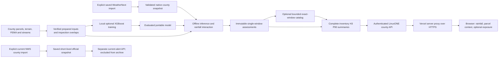

# Architecture at this code checkpoint

The graph describes implemented code paths. [The model run report](../modeling-run-v1.md) records local training and one local assessment. [The runtime activation record](../real-data-rollout.md) records earlier LinuxONE county geometry/context serving. The [fresh execution checkpoint](verified-run.md) now verifies isolated LinuxONE inference, cross-host parity, the existing activated API path and all 25 transferred assessments. The optional catalog was validated separately; it is not the active directory configuration. A current NWS fetch succeeded without activating a current UI or refresh job.

Python serves the API and committed React/Tailwind assets without third-party runtime dependencies. Training and polygon preparation use a separate optional environment. Portable inference does not install native ML libraries on `s390x`. A Dockerfile describes packaging; it does not establish a target-host container build or run.

The browser receives only a Mapbox public `pk.` token. Snapshot and parcel tokens remain on servers. Vercel forwards narrow authenticated requests; a source failure stays unavailable. SQLite inputs are opened read-only. Scoring is explicit offline work, never a consequence of a page request. A catalog takes precedence over single-file exposure configuration and cannot fall back to a different release or window.

WeatherNext remains at native 0.1-degree resolution. County-clipped H3 rainfall is a maximum of overlaps; exposure is P90 across complete indexed parcel memberships. Unknown parcels remain in coverage denominators, not the P90 sample. Neither aggregation increases weather resolution. H3 membership counts across cells are not a unique county total.

Hosted application access is public; the source APIs remain authenticated. The optional laptop Wi-Fi sharing gate is a separate utility. Fictional-site, what-if, routing and notification endpoints remain retired. No scheduler, delivery system, operational monitoring or verified current-forecast refresh is claimed.
